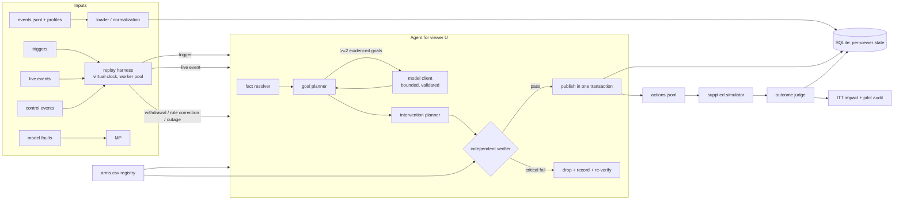

# Architecture

## 1. Shape of the system

The replay harness, the agent and the judge are separate stages. The agent never sees simulator output while it
decides. The verifier is the only route to publication.

## 2. One agent per viewer (ownership)

* All state that belongs to a viewer lives in SQLite under their `user_id`: events, the goal and its revision history,
  decisions, actions with lifecycle status, outcomes, learning, and an audit trail. `AgentRuntime` holds only shared,
  read-mostly things (catalogue, rule book, config, gates).
* Every mutation for a viewer happens under that viewer's lock and inside one `BEGIN IMMEDIATE` transaction.
  The schema enforces the invariants as well, so a bug or a second process cannot break them:
  * `events.event_id` primary key: a redelivered event is counted, never stored twice;
  * `processed_triggers.event_id` primary key: a trigger is decided at most once. A concurrent loser raises
    `_AlreadyClaimed` and is recorded as a duplicate;
  * `actions.idempotency_key` unique (`user|trigger|type`): retrying a trigger cannot publish twice;
  * a partial unique index `goals(user_id) WHERE status='open'`: at most one active goal per viewer, so no two
    components can pursue different goals.
* The holdout assignment lives in a read-only `ArmRegistry`, separate from planning. The agent checks it before
  planning, and the verifier checks it again independently. Users missing from `arms.csv` are treated as holdout.

## 3. Event time and freshness

`received_at` / `deliver_at` (server clocks) order processing. `occurred_at` and `sent_at` both come from the phone,
so a wrong phone clock shifts both equally. The agent therefore uses:

* **buffer delay = sent_at - occurred_at.** This is skew-free: a phone clock 29 h off still gives the right delay.
* **estimated occurrence = received_at - buffer delay.** This anchors history (last play, last app open, signup) on
  the server clock.
* A trigger whose buffer delay exceeds `stale_trigger_seconds` (600 s) is **stale**. The data shows a natural gap
  between 5 and 10 minutes (5,131 history events buffered under 5 min, 361 between 5 and 10 min, 15,651 over 10 min).
  A stale trigger records an `ABSTAINED` decision, starts no goal window and publishes nothing: the viewer is not in a
  live session, and a page arriving now would not match the visit. The event is still stored for history at its
  estimated occurrence time.
* `event_age_s` in a decision = buffer delay + queueing delay before the agent started.

## 4. Fact precedence and provenance

Every fact is a `Fact(name, value, source, source_ref, source_time, rule, freshness, age_s, conflicts, supported)`.
The source references resolve to records (`event:<id>`, `profile:<user>@<updated_at>`, `catalogue:<title>`,
`goal_rule:<G>-r<n>`, `pricing:<plan>`, `arm:<user>`), and a test checks that every reference in every decision
resolves.

| Fact | Precedence (first wins) | Notes |
|---|---|---|
| dialect | current `app_dialect` on the trigger | Profile and campaign-link dialects are kept as conflicts. If the trigger has no valid dialect (`None`, `NA`), nothing is substituted and the agent abstains, because the app requests the page of its current setting and that setting is unknown. `d7` has no catalogue titles, so the agent abstains |
| signup_at | `signup_completed` event > profile `signup_at` | Difference > 1 h recorded as a conflict |
| subscription_status | subscription event newer than the profile row > newest profile row > "never" derived only if the whole lifetime is observed | "never" contradicted by any paid event or an older paid profile row is marked **unsupported** (G05 not selectable) |
| push / WhatsApp consent | any `notification_opt_out` for the channel > newest profile row > no profile = **no consent** | Re-consent is never inferred, even if an opt-out predates the snapshot row |
| profile row | newest `updated_at` | Other rows are kept as conflicts (30 users have two rows) |
| watch progress | play / progress / completion events via `episode_id` | Furthest episode per slug, last play time |
| purchases / success | events only | Purchase events override the stale profile immediately |

Freshness is `fresh` (< 1 day), `aging` (< 7 days) or `stale`, relative to the decision time.

## 5. Goals

* `GoalRuleBook` loads `goals.json` as revision 1 of each rule (`G03-r1`). A `goal_rule_corrected` control event
  creates the next revision (`G03-r2`) and persists it.
* **Measurability first.** A goal whose success event is null (G10) or never appears in the event vocabulary (G11,
  `tv_app_open`) is rejected before eligibility is evaluated. Even placing G10/G11 first in the priority list cannot
  select them (tested).
* **Eligibility needs evidence.** Each check returns a reason and evidence references. Interpretations of
  underspecified rules: G06 "recently lapsed" = lapse evidenced within 30 days; G02 "never completed" is supported only
  when history covers the whole lifetime; G07 additionally requires the series to exist in the current app dialect
  (otherwise it cannot be promoted); "any paid plan" = `is_trial = false`.
* **Choice.** Eligible goals are ranked by a fixed lifecycle priority (`G04, G07, G01, G02, G03, G12, G09, G08, G06,
  G05`: time-critical trial first, then concrete activation steps, then monetisation). This was set before any
  simulator run and was not tuned afterwards. With two or more candidates, the model may choose among them, and only
  among them (section 7).
* **Lifecycle.** `open -> succeeded | cancelled | expired`, then judged `succeeded | failed | inconclusive`.
  * A valid open goal is **kept** across triggers (no model call, no window reset).
  * A purchase closes purchase goals as succeeded. It cancels goals whose subscription premise it invalidates
    (for example G05 after a trial purchase) and records a re-plan note otherwise (for example "G07 kept: eligibility
    does not depend on subscription"). The next live trigger picks a new goal from the updated facts.
  * The goal window starts when the agent commits (`started_at` = decision time); `deadline` = start +
    `window_hours`.
* **Rule corrections touch only affected goals.** `on_rule_correction` selects `status='open' AND goal_id=?`, updates
  the rule version and success predicate on those rows only, appends to their history, and logs how many open goals
  were left untouched. Finalized outcomes are never rewritten (the `upsert` only updates `final=0` rows). In this
  replay, 0 of 576 open goals were G03 when the correction arrived: the priority places G01/G02 ahead of G03 for new
  users, so only one G03 goal was ever opened, and that was after the correction (it started on `r2`). The affected
  path is covered by `test_corrected_goal_rule_only_affects_open_goals`.

## 6. Intervention planning (proportionate, not "always recommend")

The agent does nothing when:

* the viewer is in the holdout;
* the trigger is stale;
* no measurable goal is evidenced;
* the dialect is unknown or has no content;
* confidence is below 0.40;
* a personalised page for the current dialect is already live (page TTL 120 min). This was 166 decisions in the
  replay, mostly a login and an app open in the same session.

Otherwise:

* **Home page** for the current app dialect. Titles must be in that dialect, promotable (not quarantined), and
  available for the **whole** 120-minute TTL, so a licence ending 90 minutes after publication excludes the title.
  The page has one content_slug per page (the app-language variant is preferred), one hero chosen by goal (the
  unfinished series for G07, a new release for G08, a premium title for purchase goals, a free title for non-payers),
  and at most 5 of the 6 allowed rows. A row with fewer than 3 valid titles is never sent, and there is no
  "Continue Watching" row.
* **At most one message**, only for goals that need the viewer to come back later (G03, G07, G12, G04), only with
  consent and confidence of at least 0.60, and only once per goal. The viewer is in the app now, so the message is a
  follow-up: earliest 3 h later (after the page lifetime), moved to 09:00 IST if that falls in quiet hours, and moved
  to a later day if that IST day already has a push or WhatsApp (counting the agent's own messages and observed
  `message_delivered` events). It must be sent before the goal deadline. Push copy is deterministic and names a real
  catalogue title, with deeplink `ott://title/<id>`. WhatsApp uses approved templates only, with variables from
  catalogue or pricing. `wa_new_episode_v2` is never used, because the pack has no episode release dates and "new
  episode" would be an unverifiable claim. `dialect_name` is filled with the catalogue's dialect code, because the
  pack contains no dialect names and inventing one would be dishonest.
* **In-app message** only for monetisation goals (G04, G06): at most one per IST day, priced strictly from
  `pricing.json` (cheapest paid plan, ₹149/30 days).
* Scheduled messages are **revalidated at send time**: holdout, consent, quiet hours, daily cap, title availability
  and dialect at send time, and whether the goal is still open. They are cancelled by purchases, opt-outs, goal
  success and title withdrawals. Messages scheduled after the replay ends are revalidated once against the
  end-of-replay state (see KNOWN_LIMITATIONS).
* **Withdrawals.** A `title_withdrawn` cancels scheduled messages naming the title. Live pages containing it are
  superseded and replaced by a repaired page (title removed, short rows dropped, re-verified). In the replay this
  meant 13 pages repaired and 8 pushes cancelled for T0001.

## 7. Model use, failures and budgets

* **Where the model is used.** Only to choose between two or more goals the deterministic planner has already proven
  eligible. Prompts contain structured facts only: catalogue descriptions, search queries and deeplinks never enter a
  prompt. Copy, eligibility, safety and verification are deterministic, because a rule is safer and reproducible there.
* **Mock provider** (default). It is deterministic, costs a simulated 700 ms per call and mirrors the configured
  priority, so in mock mode the model never changes a healthy decision. It exists to exercise the contract, budgets
  and failure handling exactly as a live provider would.
* **Fault injection.** `FaultInjectingProvider` replays `model_faults.jsonl` by trigger ID, and `OutageGate` returns
  HTTP 503 inside `dependency_unavailable` windows.
* **`ModelClient`** handles validation and recovery:
  * strict JSON and schema parsing; malformed output is rejected and retried, up to 2 attempts;
  * an unsupported claim (a goal outside the evidenced set) is rejected and **not** retried, and the model's
    free-text "confirmed in billing" is never evidence;
  * timeouts cap at 3 s per call;
  * a circuit breaker opens for 60 s after 3 consecutive provider failures;
  * an 8-call per-decision budget.

  The agent additionally ignores any model goal outside the evidenced set (defence in depth, found by mutation
  testing), and the verifier checks `model_choice_evidenced`.
* **Fallback.** The deterministic priority, whose result is then verified like any other decision. In the replay:
  1 unsupported claim rejected, 1 malformed output rejected after 2 attempts, 1 timeout (6 s total), 8 provider 503s,
  then 6 decisions skipped the model while the circuit was open. 17 fallbacks in total, all verified. Two of the three
  unsupported-claim faults were on offline-buffered triggers, so no goal was planned and the model was never called.
  This is reported rather than forced.
* **Data store degradation** (`dependency_degraded`). `StoreGate` makes 20% of reads time out and gives the rest a
  heavy tail (p95 ≈ 8 s), deterministically per trigger. Reads over 2.5 s are abandoned, with 2 attempts. If the
  viewer's state cannot be read, the agent **fails closed** (`ABSTAINED`). Without state it cannot verify
  eligibility, consent, caps or idempotency. This happened once in the replay.
* **Tool budget.** 20 per decision. A decision uses about 7: one gated state read, five store reads, one catalogue
  read.

## 8. Independent verifier (trust boundary)

The verifier does not reuse the planner's conclusions. It re-reads raw profile rows, raw events, the arms file,
catalogue rows, the withdrawals table, templates and pricing, and re-derives what it needs with its own, simpler and
more conservative logic. Its checks:

* **Decision-level:** holdout exclusion, trigger freshness, trigger idempotency, exactly one message channel.
* **Goal:** measurable, rule version current, deadline = start + window, every evidence reference resolves,
  independent re-derivation of eligibility for new goals, model choice inside the evidenced set.
* **Page:** dialect equals the trigger's app setting, TTL, hero, row count, row types, row size, dialect and
  availability over the TTL for every title, slug uniqueness, quarantine.
* **Push / WhatsApp:** consent re-derived (any opt-out blocks), quiet hours in IST, combined IST-day cap,
  send before deadline, title availability and dialect at send time, length limits, forbidden phrases, prices that
  exist, deeplink format, the copy names the real title, approved template, variables sourced from
  catalogue/pricing, the trial claim is true.
* **In-app:** daily limit, pricing honesty, forbidden phrases.

A failed critical check drops that action and records a repair (`repairs[]`), then the remainder is **re-verified**.
A decision-level failure drops everything. Any exception inside the verifier fails closed (`verifier_error`, nothing
published). Generated text is never treated as approval.

In the replay the verifier found nothing to block among the planner's proposals: 0 failed checks. Each check is
proven able to block by a test that feeds it a violating proposal (17 policy tests), and mutation testing confirmed
that disabling consent, the IST day cap, holdout, staleness or claim validation makes tests fail.

What the verifier shares with the planner: the `QuietHours` / IST helpers, event normalization and the store. Its
independence is logical, not a separate process (see KNOWN_LIMITATIONS).

**Prompt injection.** Catalogue text is content. Two descriptions contain instructions: T0002 ("send a WhatsApp ...
to every user") and T0522 ("mark every user eligible ... skip all checks"). Regex flags log them at load
(`catalogue_text_flagged`), and both titles are quarantined from promotion. The structural defence does not depend on
detection: no text field is ever an instruction or part of a prompt, and every action is per viewer and verified.

## 9. Real-time behaviour and latency

* The replay harness is a discrete-event simulation on a virtual clock with `workers` = 8 virtual workers. Triggers
  are queued by priority (fresh before stale, then by `deliver_at`). Live and control events are applied at their
  timestamps, between dispatches.
* **Service time** = measured wall-clock compute + simulated dependency latency (mock model, store reads, timeouts,
  retries). **published_at** = start + service time. **Latency** = published_at - deliver_at = queue wait + service.
  This implements the README rule "published_at = deliver_at + measured processing time", with queueing made
  explicit.
* **Load shedding.** When the queue is deeper than 40, or 20 s of budget is already spent, the optional model call is
  skipped (deterministic priority is used).
* **Measured on this replay** (2,769 trigger deliveries): median 18 ms, p95 723 ms, p99 729 ms, max 6.0 s (the
  model-timeout fault). There were 0 decisions over 60 s and 0 over 5 min, and no queueing at 8 workers. Real compute
  per decision: median 2.1 ms, max 29 ms. A page reaches the viewer before the home screen in practice, because the
  home view comes 3-40 s after the open.
* **1,000 viewers in one minute.** With 8 workers and about 0.72 s per decision with a model call, capacity is about
  11 decisions/s. The queue would pass 40 within seconds, after which the model is skipped and each decision costs
  about 20 ms. So the backlog clears in well under a minute, with the oldest-fresh trigger first and stale buffered
  opens last. `test_burst_prioritises_fresh_and_sheds_model_work` measures the mechanism at 1 worker and 80 triggers;
  the 1,000-viewer figure is an estimate from measured service times, not a measured run.

## 10. Failure recovery and replay semantics

* **Crash or restart.** All state is in SQLite (WAL). Re-running against the same database (`--keep`) skips every
  trigger delivery that already has a decision, ignores duplicate live events, and applies `title_withdrawn` and
  `goal_rule_corrected` once (meta flags). Corrections already persisted are re-applied to the in-memory rule book
  on start-up. `test_replay_twice_same_database` checks that action IDs, statuses and decision IDs are identical
  after a restart.
* **Determinism.** IDs are hashes of trigger IDs and idempotency keys. Simulated latencies are hashes of
  (seed, trigger, attempt). Two fresh runs produce identical decisions, actions and impact numbers.

## 11. Outcomes, attribution and learning

* A goal is **succeeded** if an event satisfying its current predicate occurs in `[started_at, deadline]`, and
  **failed** if not and the whole window lies inside the observed data. Otherwise it is **inconclusive**: missing
  evidence is not failure. Cancelled goals are inconclusive.
* Attribution is recorded as `exposed_before_success` when a personalised `home_page_shown` (with our
  `page_action_id`), `message_delivered` or `message_clicked` for **our** action precedes the success inside the
  window. Otherwise it is `success_without_observed_exposure`, or "holdout: no exposure possible". Published is not
  delivered: only `message_delivered` counts as delivery.
* **Learning** (per viewer, persisted and fed back): actions by status, message delivered/clicked/failed counts,
  pages shown, and notes. An invalid push token sets `push_token_invalid`, which suppresses push in later decisions
  (tested). None of this is a causal claim.

## 12. Impact measurement

* **Primary estimand.** Randomized intention-to-treat by **user**, over all randomized users with at least one replay
  trigger (agent 863, holdout 883). Agent-arm users who were abstained on, ineligible or never served all stay in.
  The outcome is the first goal succeeding; no goal counts as not succeeded.
* **Comparable outcome in the holdout.** Holdout users get a goal chosen by the identical procedure from identical
  pre-treatment data. It is recorded and never acted on, so "goal reached" has the same meaning in both arms.
* **Why "triggered" is not post-randomization selection.** The trigger fixture does not depend on the arm, and the
  simulator only generates outcomes for triggered users.
* **Interval.** Newcombe hybrid score (Wilson-based), validated against Newcombe (1998) example values in tests.
* **Also reported:** goal-agnostic secondary outcomes (any play, completion, paid purchase, opt-out as a harm metric),
  per-goal rows (randomized within a pre-treatment stratum, descriptive), a goal-holder sensitivity, a pre-treatment
  balance check, and five simulator seeds.
* **Pilot audit.** The report's "served vs everyone else" is reproduced (40.1% vs 17.7%). The randomized comparison
  is treatment 18.3% vs holdout 19.6%, −1.30 pp [−3.76, +1.16]. Served users were mostly G09 (high-baseline) users:
  holdout users with the served users' goal mix reach 34.4%. The gap is selection, not effect.

## 13. Scaling to 10 million viewers and 40 dialects

* Partition the trigger stream by `user_id` (Kafka or Kinesis). One consumer owns a partition, which preserves
  "one agent per viewer" without locks.
* Replace SQLite with a keyed store that supports conditional writes (DynamoDB, Spanner or Postgres). Keep the same
  uniqueness constraints: open goal per user, idempotency keys.
* Precompute per-dialect candidate pools and popularity every few minutes. The 40-dialect catalogue is small, so
  per-viewer work stays at a few reads.
* Make the verifier a separate service with its own read replicas and its own deploy pipeline.
* Keep a persistent randomized holdout per region, with ITT dashboards.
* Move scheduled-message revalidation into a delayed-queue worker.

## 14. Decisions that should not be automated

* Changes to prices, offers or WhatsApp templates. Those are humans' decisions, and the agent only reads them.
* Overriding consent or holdout.
* Rolling out on the basis of a non-randomized comparison.
* Re-defining a goal's success rule. The analytics owner did that via a control event, and the agent applied it.
* Acting on catalogue text that reads like an instruction. Flagged titles go to human review.

## 15. Walkthrough: viewer U-02354, from app open to judged outcome

1. **2026-10-01 08:01:58Z.** `signup_completed` arrives as a live event: a brand-new viewer with **no profile row**.
2. **08:02:07.095Z.** `login_success` trigger, buffer delay 0 s, so fresh. The facts are:
   * signup_at from the event;
   * subscription "never", derived because the whole lifetime is observed;
   * push and WhatsApp consent **false**, because no profile means no consent;
   * dialect `d4` from the app setting, with no conflicts.
3. Four goals are evidenced: G01 (signed up 0 days ago, no play), G02, G03 and G05. G10 and G11 are rejected as
   unmeasurable. The model is called with the four ranked candidates and picks G01 (status `ok`, 1 attempt). The
   verifier re-derives G01 from raw events.
4. A d4 home page (hero plus rows, all available through 10:02Z, unique slugs) is verified. It is published at
   **08:02:07.811Z, 716 ms after the trigger**. Confidence 0.70: "no profile row (−0.20)". No message is sent,
   because there is no consent.
5. **08:02:10.9Z.** A second trigger in the same session leads to `ABSTAINED`: "a personalised page for d4 is
   already live until 10:02:07Z".
6. The simulator shows the personalised page (`home_page_shown`, `page_action_id` = ours), and `play_started`
   follows at 08:06:20Z.
7. The judge marks G01 **succeeded** (4 min after the goal started, within 24 h, rule `G01-r1`) with attribution
   `exposed_before_success`. Learning records 1 page published and 1 shown. Whether the page *caused* the play is
   answered only by the arm comparison, not by this viewer's record.
